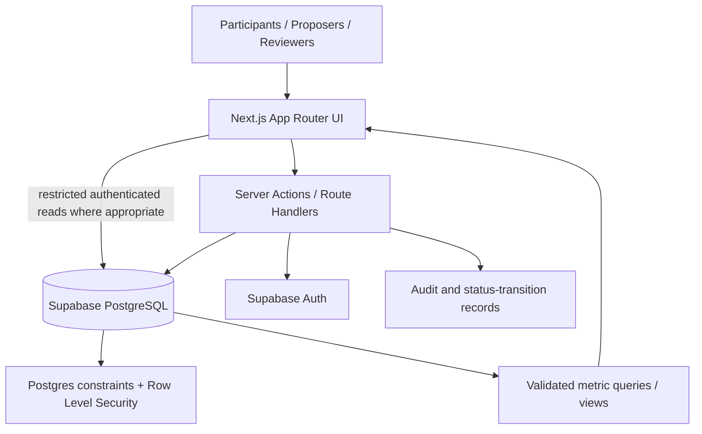

# 04 — System Architecture

## 1. Recommended MVP stack

| Layer | Choice | Reason |
|---|---|---|
| Web framework | Next.js App Router + React + TypeScript | One codebase for responsive UI and server-side application logic; broad tooling support for AI-assisted development |
| Styling/components | Tailwind CSS + shadcn/ui | Fast iteration with reusable accessible components; customize the identity rather than shipping a generic template unchanged |
| Database | Supabase PostgreSQL | Relational model suits projects, varieties, profiles, submissions, tests, and decisions |
| Authentication | Supabase Auth | Avoid rebuilding account flows; connect authorization to database policies |
| Backend | Next.js Server Actions / Route Handlers for mutations and protected operations | No separate Express service for MVP; introduce a separate service only when justified |
| Validation | Zod plus server-side checks | Validate incoming data at trust boundaries |
| Forms | React Hook Form + Zod (optional, if project needs it) | Manage multi-step forms without ad hoc state everywhere |
| Charts | A lightweight React chart library (e.g. Recharts) | Display multiple transparent measures; avoid one opaque ranking score |
| Tests | Vitest + React Testing Library + Playwright; Supabase DB/RLS tests | Unit, component, end-to-end, and authorization coverage |
| Deployment | Vercel for web + Supabase hosted services | Low-operations deployment, preview deployments, managed database/auth |
| Package manager | pnpm (recommended) | Consistent dependency management; npm is acceptable if the agent/toolchain requires it |

This is a recommendation, not a claim that every AI coding agent is universally better at Next.js than MERN. The architecture is chosen to keep the MVP compact and the relational data model clear.

## 2. High-level diagram



## 3. Application boundaries

### Browser/client
- Renders lessons, tests, project pages, dashboards and forms.
- Can use publishable/anonymous Supabase credentials only under carefully designed RLS policies.
- Never receives the Supabase secret/service-role key.
- Does not decide that a user is an admin merely because local state says so.

### Server layer
- Validates input and auth claims.
- Enforces project membership, role, review status, eligibility, rate limits and state transitions.
- Creates XP ledger entries idempotently.
- Computes or requests approved metric calculations.
- Writes immutable audit events for governance actions.

### PostgreSQL
- Stores relational product data and consent/provenance flags.
- Enforces foreign keys, uniqueness and valid state constraints.
- Uses RLS for all client-accessible tables and tests allow/deny cases.
- Provides views or server-side queries for aggregate results, with small-cohort protections.

## 4. Proposed repository layout

```text
lipi-sabha/
  app/
    (public)/
    (auth)/
    (participant)/
    projects/
    admin/
    api/                 # only when a Route Handler is appropriate
  components/
    ui/
    projects/
    quests/
    evidence/
  lib/
    auth/
    permissions/
    validation/
    metrics/
    gamification/
    audit/
    supabase/
  types/
  supabase/
    migrations/
    seed.sql              # synthetic demo content only
    tests/                # RLS/policy tests
  tests/
    unit/
    e2e/
  docs/                   # copy/update this specification
```

## 5. Security essentials

- Use the least privilege necessary for each role.
- Enable RLS on every exposed table and explicitly review grants and policies.
- Test permitted and denied operations for signed-out users, participants, project members, reviewers and admins.
- Do not put `service_role`/secret keys in `NEXT_PUBLIC_*` variables, client components, source control, logs or generated examples.
- Trust server-side role claims/database records, not client-submitted role names.
- Validate all mutations on the server even if forms also validate client-side.
- Use rate limiting or abuse controls for proposals, comments and test submission endpoints.
- Keep audit events for project approval and outcome changes.
- Minimize public exposure of free-text responses and participant attributes.
- Suppress small subgroup results; default minimum display cohort is 5 participants and must be reviewed for the actual data/context.

## 6. Data and metric rules

- Do not normalize spellings in a way that erases linguistically meaningful distinctions.
- Record the exact normalization/evaluation rule used for each metric version.
- Free-text answers are not automatically “wrong” when they fail an exact string match; use accepted-form rules or review status.
- Aggregate results must state sample size, item count, version of candidate conventions, and review state.
- Separate task accuracy, spelling agreement, learning measures, preference, and community alignment.

## 7. Source references

- Next.js App Router: https://nextjs.org/docs/app
- Supabase Row Level Security: https://supabase.com/docs/guides/database/postgres/row-level-security
- Supabase Auth: https://supabase.com/docs/guides/auth
- Vercel deployment environments: https://vercel.com/docs/deployments/environments

Official documentation is a living source; check it again when implementation begins.
