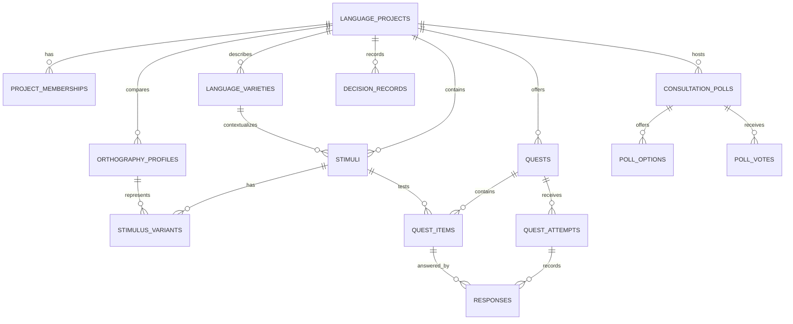

# 05 — Data Model (MVP)

This is a logical schema proposal, not a final migration. The coding agent should create migrations and tests; it must not change core semantics silently.

## 1. Main entities

### `profiles`
- `user_id` UUID, primary key and foreign key to `auth.users`
- `display_name`
- `created_at`, `updated_at`
- optional locale/preferred UI language
- optional broad language-variety tags only when user chooses to share them
- no precise address or unnecessary sensitive profile fields

### `platform_roles`
- `user_id`
- `role` (`governance_admin`, `moderator`, optionally `linguist_reviewer`)
- `granted_by`, `granted_at`, `reason`
- role grants are server/admin controlled

### `language_projects`
- `id`, `slug`, `name`, `alternate_names`
- `broad_region_label` (optional, user-supplied, not precise location)
- `problem_statement`, `goal`, `scope` (`word`, `phrase`, `both`)
- `proposer_id`, `status` (`draft`, `submitted`, `under_review`, `changes_requested`, `approved`, `active`, `paused`, `closed`, `rejected`)
- `reviewed_by`, `reviewed_at`, `review_reason`
- `community_process_summary`, `created_at`, `updated_at`

### `project_memberships`
- `project_id`, `user_id`
- `project_role` (`coordinator`, `linguist_reviewer`, `participant`, `community_governance_member`)
- `status`, `invited_by`, `accepted_at`
- unique `(project_id, user_id, project_role)` or a stricter membership design after implementation review

### `language_varieties`
- `id`, `project_id`, `name`, `description`
- `status` (`proposed`, `reviewed`, `not_documented`)
- optional broad contextual description
- do not treat the list as exhaustive or externally authoritative

### `orthography_profiles`
- `id`, `project_id`, `label`
- `script_name` (e.g., a script label)
- `convention_summary`, `rules_document`, `examples`
- `provenance`, `review_status`, `reviewer_id`, `review_notes`
- `version`, `created_at`, `updated_at`

An orthography profile means **script + spelling conventions**, not simply “language = script”. Keep profiles versioned so a test can be tied to the exact rule set used.

### `stimuli`
- `id`, `project_id`, optional `variety_id`
- `stimulus_type` (`word`, `phrase`)
- `reference_form` (only when the project’s method establishes what this field means)
- optional `pronunciation_note`, optional consented `audio_asset_path`
- `source_description`, `consent_basis`, `attribution_preference`
- `review_status`, `reviewer_id`, `review_notes`
- `created_by`, timestamps

### `stimulus_variants`
- `id`, `stimulus_id`, `orthography_profile_id`
- `written_form`, optional `pronunciation_note`
- `variant_status` (`reported`, `reviewed`, `accepted_for_task`, `disputed`, `retired`)
- `source_description`, `contributed_by`, attribution preference
- no global boolean `is_correct` without a task-specific reviewed criterion

### `quests` and `quest_items`
- `quests`: project, title, description, status, estimated time, published version
- `quest_items`: quest, stimulus, orthography profile, question type, position, task-specific criterion, feedback text
- only reviewed items with valid criteria can be included in scored tasks

### `quest_attempts`
- `id`, `quest_id`, `user_id`, `started_at`, `completed_at`, `consent_version`, status
- retain only the data necessary for the stated use

### `responses`
- `id`, `attempt_id`, `quest_item_id`, `selected_variant_id` nullable, `free_text_response` nullable
- `response_metadata` with strict allowlist (avoid arbitrary sensitive content)
- `evaluation_status` (`not_scored`, `auto_scored_by_rule`, `needs_human_review`, `reviewed`)
- optional `evaluation_result`, `evaluation_rule_version`, timestamps
- ensure one intended response per attempt/item or explicitly support revisions

### `xp_ledger` and `badges` / `user_badges`
- ledger entries are append-only and idempotent, with reason, event id, amount and timestamp
- badges have a stable identifier and clear eligibility rule
- XP cannot be earned for voting for an option or matching the majority

### `consultation_polls`, `poll_options`, `poll_votes`
- poll belongs to a project and describes the question, scope, eligible group, open/close time, method, and whether the poll is non-binding consultation or part of a previously defined decision process
- one eligible vote per user/poll by default
- poll votes must not automatically mutate orthography profile status

### `decision_records`
- `id`, `project_id`, outcome type (`decision_recorded`, `more_testing_needed`, `no_consensus`, `no_decision_yet`)
- decision method and link to relevant poll/evidence version
- summary of evidence considered, dissent/limitations, recorded_by, authorized basis, date, optional review date
- decision must not be generated from a metric threshold alone

### `review_events` / `audit_events`
- actor, action, target type/id, prior state, new state, reason, timestamp
- restrict mutation/deletion to authorized service pathways

## 2. Relationship sketch

## 3. Constraints and indexes to consider

- Foreign keys on all relationships.
- Unique project slug; unique membership and user/poll vote rules.
- State-transition validation for proposal review and project activation.
- Index membership lookups by `(project_id, user_id)` and user response/attempt queries.
- RLS on each client-exposed table plus explicit GRANT review.
- Make the secret/service role server-only.
- Small-cohort suppression must be enforced in the query/data-access layer, not only by hiding a chart label.
- Data deletion/retention rules should be decided before production use, especially for audio and free-text responses.

## 4. MVP simplifications

- No vector database or embeddings.
- No general-purpose graph database.
- No custom model-generated spelling acceptance.
- Audio is optional and only enabled for assets with documented permission; a text-only synthetic demo is acceptable.
- Keep early metrics as transparent SQL/server-side calculations with tests.
