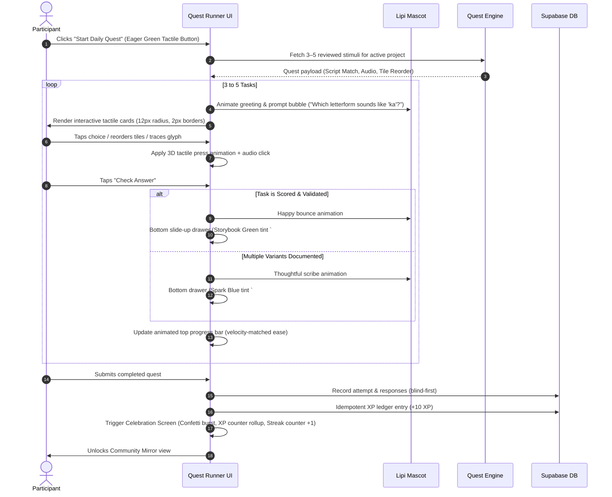

# 03 — UX Flows and Screen Map

**Product:** Lipi Sabha (लिपि सभा)  
**UX Archetype:** Duolingo-style playful storybook learning loop paired with collaborative community governance  
**Design Reference:** [`00-design-system.md`](./00-design-system.md) & [`design.md`](./design.md)  
**Motion Doctrine:** Velocity-matched seams, waterfall card entries, and tactile 3D press feedback.

---

## 1. Global Navigation Architecture

```mermaid
flowchart TD
    ROOT[Lipi Sabha App Root] --> PUBLIC[Public / Signed-Out Portal]
    ROOT --> AUTH[Authentication Flow]
    ROOT --> APP[Participant App Shell]
    ROOT --> WORKSPACE[Project Coordinator Workspace]
    ROOT --> ADMIN[Governance & Moderation Hub]

    PUBLIC --> LANDING[Storybook Landing Page & Script Showcase]
    PUBLIC --> EXPLORE[Public Approved Projects Explorer]
    PUBLIC --> ABOUT[Lipi Sabha Mission & Governance Manifesto]

    APP --> DASH[Scribe Dashboard / Daily Quest Hub]
    APP --> QUEST[Interactive Bite-Sized Quest Engine]
    APP --> MIRROR[Community Mirror & Evidence Viewer]
    APP --> PROGRESS[Scribe Journey / Streaks & Badges]
    APP --> PROFILE[Profile & Macro-Variety Settings]

    WORKSPACE --> PROPOSAL[Proposal Authoring & Revisions]
    WORKSPACE --> ORTHO_BUILDER[Candidate Orthography Manager]
    WORKSPACE --> DATASET[Word & Phrase Dataset Manager]
    WORKSPACE --> QUEST_BUILDER[Quest Builder & Dry-Run Preview]
    WORKSPACE --> POLL_MGR[Consultation Polls & Decision Logger]

    ADMIN --> PROP_QUEUE[Proposal Review & Governance Queue]
    ADMIN --> MOD_QUEUE[Flagged Content & Trolling Moderation]
    ADMIN --> AUDIT[Immutable State & Governance Audit Log]
```

---

## 2. Core User Journeys

### Journey 1: The Daily Quest & Learning Loop (Duolingo-Grade Flow)

---

## 3. Screen Specifications & States

### Screen S-01: Scribe Dashboard (Home)
- **Top Navigation Bar:**
  - Lipi Sabha logo (playful script glyph + feather quill).
  - Streak Flame counter (Coral Fire `#ff4b4b` with flame icon and day count).
  - XP Pill (Sun Yellow `#ffc800` with star icon).
  - User avatar with current Scribe Rank (e.g., "Script Apprentice").
- **Hero Daily Quest Card:**
  - Chunky white card with 2px solid border in `#e5e5e5`.
  - Mascot illustration on the right encouraging the user.
  - "Daily Quest: Discover 4 Sharada Vowels" (19px subheading, Charcoal `#4b4b4b`).
  - Tactile primary button: "Start Quest — 3 Mins" in Eager Green (`#58cc02`).
- **Active Projects Carousel:**
  - Cards showing approved projects (e.g. "Modi vs Devanagari in Marathi Orthography").
  - Status chips: `Actively Testing`, `Community Review`, `340 Responses`.

### Screen S-02: Interactive Quest Runner
- **Header:**
  - Close button (`X` icon, ghost button).
  - `<QuestProgressBar />`: 16px pill bar filling smoothly from 0% to 100%.
  - Ink Drop indicator (representing available practice attempts).
- **Stage (Center):**
  - `<LipiMascotBubble />`: Mascot delivers the challenge with speech bubble.
  - **Dynamic Task Canvas:**
    - *For Script Match:* 2x2 grid of chunky `<ScriptTileCard />` components.
    - *For Phrase Builder:* Word chip tray with tap-to-assemble physics.
    - *For Audio Discrimination:* Circular Spark Blue speaker button with sound wave animation.
    - *For Blind-First Comparison:* Side-by-side Option A and Option B comparison cards.
- **Footer Action Band:**
  - Sticky bottom container on white canvas.
  - "Check" / "Continue" button: Full-width or right-aligned 3D tactile button with press depth.

### Screen S-03: Quest Victory Celebration Screen
- **Visuals:** Full-screen celebratory modal with confetti particle animation.
- **Mascot:** Scribe mascot dances with joy holding a finished scroll.
- **Counters:**
  - "Quest Complete!" in Feather 700 display typography (`#58cc02`, 48px).
  - XP earned ticker rolling up: `+10 XP`.
  - Streak summary: `🔥 5 Day Streak!`.
- **CTAs:**
  - Primary button: "View Community Mirror" (Spark Blue `#1cb0f6`).
  - Secondary button: "Return to Dashboard" (Outlined button `#afafaf`).

### Screen S-04: Community Mirror & Evidence Dashboard
- **Header:** Project title, version tag, and total participant sample size (`N = 142`).
- **Comparison Visualizer:**
  - Horizontal rounded bar graphs comparing Candidate Orthography A vs Candidate Orthography B.
  - Interactive Macro-Variety Toggle (e.g., "All Responses", "Konkan Region", "Vidarbha Region") with automatic low-sample suppression warnings.
- **Metrics Breakdown Cards:**
  - Card 1: Task Accuracy (scored tasks only).
  - Card 2: Orthographic Agreement (consensus index).
  - Card 3: Learnability (pre vs post completion time curves).
  - Card 4: Community Consultation Preference.
- **Trust Banner:** Persistent disclaimer: *"Community Mirror reflects descriptive participant distribution in our research sample, not a definitive verdict on correct language usage."*

### Screen S-05: Project Proposal & Workspace
- Multi-step structured form with progress pills:
  1. *Basics & Language Names*
  2. *Orthographic Problem & Goals*
  3. *Candidate Conventions & Provenance*
  4. *Community Consent & Review Plan*
- Responsive auto-save with offline draft preservation in browser LocalStorage.

---

## 4. Edge Cases & UX State Guidelines

| State | Visual Treatment | Copy Guidance |
|---|---|---|
| **Multiple Valid Forms** | Spark Blue tint wash (`#ddf4ff`), light bulb icon | *"Both forms are historically attested. Your response adds to our linguistic dataset."* |
| **Needs Review / Exploratory** | Soft amber sticker badge (`#fff4cc`) | *"This item is under review by community linguists and is not counted toward accuracy."* |
| **Low Sample Size (< 5)** | Neutral gray striped card (`#f5f5f5`) | *"Subgroup breakdown suppressed to protect participant anonymity (sample size < 5)."* |
| **Offline / Network Interruption** | Reversible offline banner with cached queue indicator | *"You are currently offline. Your quest answers are saved locally and will sync once connected."* |
| **No Consensus Outcome** | Storybook purple ribbon badge | *"Community outcome recorded: Diverse conventions acknowledged; ongoing exploratory use supported."* |

---

## 5. Micro-Copy & Voice Tone

Lipi Sabha’s voice balances **academic humility** with **playful warmth**:
* **Celebrate Effort, Never Hegemony:** We praise curiosity, consistency, and careful observation. We never praise "beating" another dialect or proving another script wrong.
* **Clarity Over Jargon:** Instead of "heterographic grapheme-phoneme divergence", we say "Different spellings for the same sound".
* **Sovereignty First:** Phrases like "The data shows" or "Our community sample indicates", never "The AI has decided".
