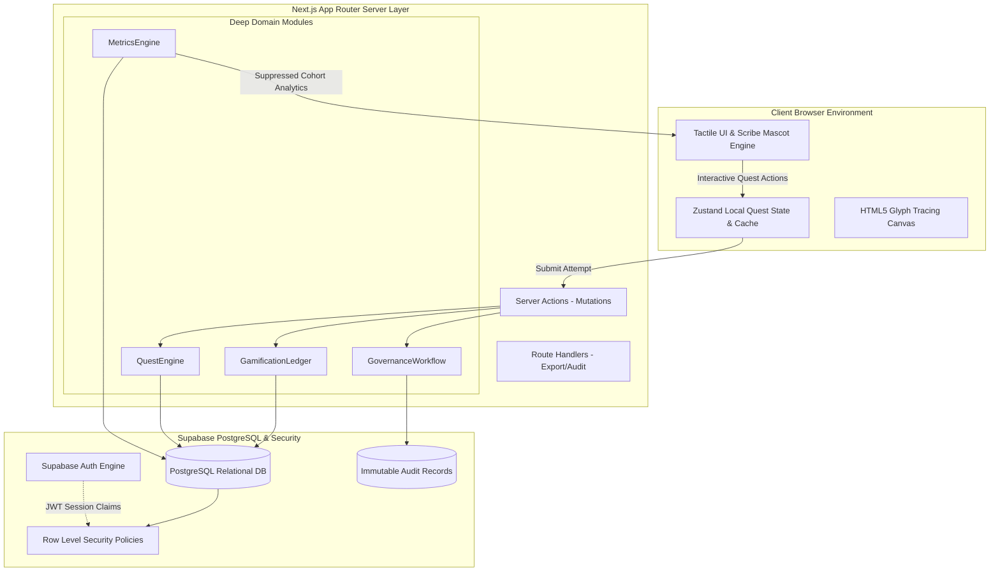

# 04 — System Architecture & Deep Module Design

**Product:** Lipi Sabha (लिपि सभा)  
**Architecture Doctrine:** Deep modules, explicit trust boundaries, relational integrity, and high-performance tactile UI rendering.  
**Engineering Methodology:** Informed by Matt Pocock’s `codebase-design` (deep seams, small surface areas, hidden state complexity) and Antigravity's `codebase-memory-mcp` knowledge graph indexing.

---

## 1. Technical Stack Architecture

| Layer | Technology Choice | Architectural Justification |
|---|---|---|
| **Web Framework** | Next.js 15 (App Router) + React 19 + TypeScript | Full-stack TypeScript architecture; React Server Components (RSC) for zero-JS landing pages and secure server actions. |
| **Styling & Design System** | Tailwind CSS v4 + Radix UI Primitives | Implements the Duolingo tactile token system ([`00-design-system.md`](./00-design-system.md)); custom 3D button press physics and sticker cards. |
| **Animation Engine** | Framer Motion + Canvas API + HyperFrames motion tokens | Delivers velocity-matched seams (`cut-the-curve`), card waterfall entries, and responsive glyph tracing canvases. |
| **Database** | Neon Serverless PostgreSQL (`@neondatabase/serverless`) + Drizzle ORM | Blazing fast connection pooling, branching, high-performance edge/serverless queries, zero vendor lock-in. |
| **Authentication** | NextAuth.js (Auth.js) + Direct Google OAuth | Direct Google Cloud OAuth provider (Client ID/Secret) + credential fallback; clean session management. |
| **Media / Storage** | Cloudinary | CDN-backed storage for manuscript scans, scribe mascot vector assets, and native audio pronunciation clips. |
| **API & Mutations** | Next.js Server Actions & Route Handlers | Server-side mutations validated with Zod schemas; strict trust boundary. |
| **Validation Layer** | Zod (v3) | Strict input and response boundary schemas preventing schema poisoning. |
| **Deployment Targets** | Vercel / Render | Native Next.js edge performance on Vercel or flexible Docker deployment on Render. |
| **Code Intelligence** | `codebase-memory-mcp` | Persistent local SQLite structural graph of symbols, call trees, and routes to streamline AI development. |
| **Testing Suite** | Vitest + React Testing Library + Playwright | Unit tests for scoring logic, component interaction tests, and end-to-end authorization tests. |

---

## 2. High-Level System Topography



---

## 3. Deep Module Seam Specifications (`codebase-design`)

To prevent spaghetti logic across UI components, Lipi Sabha's core logic is encapsulated into four **Deep Modules** characterized by narrow public APIs and rich internal mechanics:

### 1. `QuestEngine` (`lib/modules/quest/`)
* **Public Interface:**
  * `getQuestPayload(questId: string, userId?: string): Promise<QuestPayload>`
  * `submitTaskResponse(attemptId: string, response: TaskResponseInput): Promise<TaskFeedback>`
  * `finalizeQuestAttempt(attemptId: string): Promise<QuestCompletionSummary>`
* **Hidden Complexity:**
  * Manages blind-first response locks (prevents response modification after submission).
  * Automatically isolates multi-variant stimuli from binary "correct/incorrect" evaluation.
  * Encapsulates timing telemetry and practice attempt quotas.

### 2. `MetricsEngine` (`lib/modules/metrics/`)
* **Public Interface:**
  * `getProjectEvidence(projectId: string, filter?: SubgroupFilter): Promise<ProjectEvidenceReport>`
  * `getCommunityMirror(questItemId: string, varietyId?: string): Promise<CommunityMirrorDistribution>`
* **Hidden Complexity:**
  * Computes Orthographic Agreement using normalized Levenshtein and phoneme matrix distance.
  * Enforces **Small Cohort Suppression**: If any subgroup has fewer than $N=5$ respondents, raw counts and percentage breakdowns are suppressed to prevent de-anonymization.
  * Strictly decouples task performance from community preference tallies.

### 3. `GovernanceWorkflow` (`lib/modules/governance/`)
* **Public Interface:**
  * `submitProposal(data: ProposalInput, userId: string): Promise<ProposalResult>`
  * `reviewProposal(proposalId: string, decision: ReviewDecisionInput, reviewerId: string): Promise<AuditResult>`
  * `recordCommunityOutcome(projectId: string, record: DecisionRecordInput, authorId: string): Promise<OutcomeResult>`
* **Hidden Complexity:**
  * Validates state transitions using a formal finite state machine (FSM).
  * Enforces that proposers cannot review their own submissions.
  * Writes append-only audit events capturing actor, timestamps, IP hashes, and justification notes.

### 4. `GamificationLedger` (`lib/modules/gamification/`)
* **Public Interface:**
  * `awardQuestXP(userId: string, questId: string): Promise<XPAwardResult>`
  * `updateScribeStreak(userId: string): Promise<StreakStatus>`
  * `evaluateBadgeEligibility(userId: string): Promise<NewBadgesResult>`
* **Hidden Complexity:**
  * **Idempotency Guarantee:** Prevents duplicate XP awards from network re-tries via unique database transaction constraints `(user_id, event_type, reference_id)`.
  * Computes Scribe Rank thresholds without issuing penalties for missed days.

---

## 4. Repository Layout & File Structure

```text
Lipi-Sabha/
├── app/
│   ├── (auth)/                 # Login, signup, reset password
│   ├── (public)/               # Landing page, public project explorer, manifesto
│   ├── (scribe)/               # Participant dashboard, active quests, community mirror
│   │   ├── dashboard/
│   │   ├── quest/[id]/         # The interactive Duolingo-style quest runner
│   │   └── progress/           # Streaks, badges, and learning history
│   ├── projects/[slug]/        # Project detail, evidence dashboard, discussion, polls
│   ├── coordinator/            # Project workspace: orthography builder, dataset, quest authoring
│   ├── admin/                  # Governance proposal review queue, moderation, audit log
│   └── api/                    # Webhooks and export route handlers
├── components/
│   ├── ui/                     # Tactile Duolingo sticker primitives (Button, Card, Pill, Modal)
│   ├── quest/                  # ScriptTileCard, ProgressBar, LipiMascotBubble, GlyphCanvas
│   ├── evidence/               # CommunityMirrorChart, MetricsCard, VarietyFilter
│   └── governance/             # ProposalCard, ReviewChecklist, DecisionLogger
├── lib/
│   ├── modules/                # Deep modules (quest, metrics, governance, gamification)
│   ├── supabase/               # Client, server, and admin Supabase clients
│   ├── validation/             # Zod schemas for all models and inputs
│   └── utils/                  # HarfBuzz script shaping, phoneme normalization
├── types/                      # Global TypeScript definitions
├── supabase/
│   ├── migrations/             # Incremental SQL migrations
│   ├── seed.sql                # Synthetic demo data (Modi vs Devanagari test project)
│   └── tests/                  # pgTAP / RLS permission unit tests
└── Docs/                       # Canonical documentation suite
```

---

## 5. Security & Trust Boundaries

1. **Row Level Security (RLS) Isolation:**
   * `public.profiles`: readable by all authenticated users; updatable only by the owner.
   * `public.language_projects`: public reads restricted to `approved` and `active` states; `draft` and `under_review` read-restricted to project members and governance admins.
   * `public.responses`: raw participant responses are strictly non-readable by peers. Only aggregated database views with cohort suppression are exposed.
2. **Environment Variable Hygiene:**
   * Client-side bundles contain only `NEXT_PUBLIC_SUPABASE_URL` and `NEXT_PUBLIC_SUPABASE_ANON_KEY`.
   * `SUPABASE_SERVICE_ROLE_KEY` is strictly confined to server-side background handlers and never imported into client components.
3. **Data Provenance Enforcement:**
   * Every stimulus, spelling variant, and audio asset carries an explicit foreign key link to its contributor, permission basis, and reviewer verification stamp.
