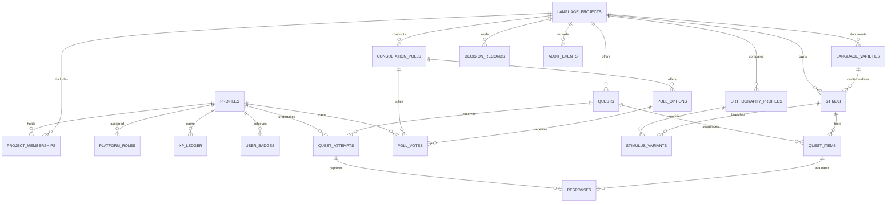

# 05 — Data Model & Schema Architecture

**Product:** Lipi Sabha (लिपि सभा)  
**Database Engine:** PostgreSQL 16+ via Supabase  
**Design Principles:** Relational integrity, auditable state machines, append-only gamification ledgers, and strict Row Level Security (RLS).

---

## 1. Relational Entity Relationship Diagram



---

## 2. Table Specifications & Columns

### 1. `profiles`
User identity and gamification telemetry:
```sql
CREATE TABLE public.profiles (
    user_id UUID PRIMARY KEY REFERENCES auth.users(id) ON DELETE CASCADE,
    display_name TEXT NOT NULL,
    avatar_url TEXT,
    preferred_ui_locale TEXT DEFAULT 'en',
    broad_variety_label TEXT,                -- Optional self-description (e.g. 'Konkan')
    total_xp INTEGER NOT NULL DEFAULT 0,
    current_streak INTEGER NOT NULL DEFAULT 0,
    longest_streak INTEGER NOT NULL DEFAULT 0,
    last_quest_completed_at TIMESTAMPTZ,
    streak_freezes_available INTEGER NOT NULL DEFAULT 1,
    scribe_rank TEXT NOT NULL DEFAULT 'Novice Reader',
    created_at TIMESTAMPTZ NOT NULL DEFAULT timezone('utc', now()),
    updated_at TIMESTAMPTZ NOT NULL DEFAULT timezone('utc', now())
);
```

### 2. `platform_roles`
Global administrative authorization:
```sql
CREATE TYPE platform_role_type AS ENUM ('governance_admin', 'moderator', 'linguist_reviewer');

CREATE TABLE public.platform_roles (
    id UUID PRIMARY KEY DEFAULT gen_random_uuid(),
    user_id UUID NOT NULL REFERENCES public.profiles(user_id) ON DELETE CASCADE,
    role platform_role_type NOT NULL,
    granted_by UUID NOT NULL REFERENCES public.profiles(user_id),
    granted_at TIMESTAMPTZ NOT NULL DEFAULT timezone('utc', now()),
    reason TEXT NOT NULL,
    CONSTRAINT unique_user_platform_role UNIQUE (user_id, role)
);
```

### 3. `language_projects`
Core project entities managed through a state machine:
```sql
CREATE TYPE project_status AS ENUM (
    'draft', 'submitted', 'under_review', 'changes_requested', 
    'approved', 'active', 'paused', 'closed', 'rejected'
);
CREATE TYPE project_scope AS ENUM ('word', 'phrase', 'both');

CREATE TABLE public.language_projects (
    id UUID PRIMARY KEY DEFAULT gen_random_uuid(),
    slug TEXT NOT NULL UNIQUE,
    name TEXT NOT NULL,
    alternate_names TEXT[] DEFAULT '{}',
    broad_region_label TEXT,
    problem_statement TEXT NOT NULL,
    goal TEXT NOT NULL,
    scope project_scope NOT NULL DEFAULT 'word',
    proposer_id UUID NOT NULL REFERENCES public.profiles(user_id),
    status project_status NOT NULL DEFAULT 'draft',
    reviewed_by UUID REFERENCES public.profiles(user_id),
    reviewed_at TIMESTAMPTZ,
    review_reason TEXT,
    community_process_summary TEXT,
    is_synthetic_demo BOOLEAN NOT NULL DEFAULT false,
    created_at TIMESTAMPTZ NOT NULL DEFAULT timezone('utc', now()),
    updated_at TIMESTAMPTZ NOT NULL DEFAULT timezone('utc', now())
);
```

### 4. `orthography_profiles`
Represents **Script + Orthographic Convention Rules**:
```sql
CREATE TYPE review_status_type AS ENUM ('reported', 'under_review', 'reviewed', 'disputed', 'retired');

CREATE TABLE public.orthography_profiles (
    id UUID PRIMARY KEY DEFAULT gen_random_uuid(),
    project_id UUID NOT NULL REFERENCES public.language_projects(id) ON DELETE CASCADE,
    label TEXT NOT NULL,                      -- e.g. 'Option A: Classical Modi'
    script_name TEXT NOT NULL,                -- e.g. 'Modi'
    convention_summary TEXT NOT NULL,
    rules_document TEXT NOT NULL,
    examples JSONB NOT NULL DEFAULT '[]',     -- Sample word pairs
    provenance TEXT NOT NULL,                 -- Historical corpus / manuscript citation
    review_status review_status_type NOT NULL DEFAULT 'under_review',
    reviewer_id UUID REFERENCES public.profiles(user_id),
    review_notes TEXT,
    version INTEGER NOT NULL DEFAULT 1,
    created_at TIMESTAMPTZ NOT NULL DEFAULT timezone('utc', now()),
    updated_at TIMESTAMPTZ NOT NULL DEFAULT timezone('utc', now()),
    CONSTRAINT unique_project_profile_label UNIQUE (project_id, label, version)
);
```

### 5. `stimuli` and `stimulus_variants`
Linguistic stimuli and candidate spellings:
```sql
CREATE TYPE stimulus_type AS ENUM ('word', 'phrase');

CREATE TABLE public.stimuli (
    id UUID PRIMARY KEY DEFAULT gen_random_uuid(),
    project_id UUID NOT NULL REFERENCES public.language_projects(id) ON DELETE CASCADE,
    variety_id UUID,                         -- Optional dialect context
    stimulus_type stimulus_type NOT NULL DEFAULT 'word',
    reference_form TEXT NOT NULL,            -- Phonetic / IPA representation
    pronunciation_note TEXT,
    audio_asset_path TEXT,                   -- Consented audio reference
    source_description TEXT NOT NULL,
    consent_basis TEXT NOT NULL,
    attribution_preference TEXT,
    review_status review_status_type NOT NULL DEFAULT 'under_review',
    reviewer_id UUID REFERENCES public.profiles(user_id),
    review_notes TEXT,
    created_by UUID NOT NULL REFERENCES public.profiles(user_id),
    created_at TIMESTAMPTZ NOT NULL DEFAULT timezone('utc', now())
);

CREATE TABLE public.stimulus_variants (
    id UUID PRIMARY KEY DEFAULT gen_random_uuid(),
    stimulus_id UUID NOT NULL REFERENCES public.stimuli(id) ON DELETE CASCADE,
    orthography_profile_id UUID NOT NULL REFERENCES public.orthography_profiles(id) ON DELETE CASCADE,
    written_form TEXT NOT NULL,
    pronunciation_note TEXT,
    variant_status review_status_type NOT NULL DEFAULT 'reported',
    source_description TEXT NOT NULL,
    contributed_by UUID REFERENCES public.profiles(user_id),
    created_at TIMESTAMPTZ NOT NULL DEFAULT timezone('utc', now()),
    CONSTRAINT unique_stimulus_profile_form UNIQUE (stimulus_id, orthography_profile_id, written_form)
);
```

### 6. `quests`, `quest_items`, `quest_attempts`, `responses`
The interactive Duolingo-style quest engine:
```sql
CREATE TYPE task_type AS ENUM (
    'script_match',          -- Match syllable sound to script glyph
    'tile_reorder',          -- Assemble phrase from word chips
    'audio_discrimination',  -- Listen and identify correct orthography
    'variant_compare',       -- Blind-first comparison between Option A & B
    'canvas_trace'           -- Trace character strokes
);

CREATE TABLE public.quests (
    id UUID PRIMARY KEY DEFAULT gen_random_uuid(),
    project_id UUID NOT NULL REFERENCES public.language_projects(id) ON DELETE CASCADE,
    title TEXT NOT NULL,
    description TEXT NOT NULL,
    estimated_time_minutes INTEGER NOT NULL DEFAULT 3,
    xp_reward INTEGER NOT NULL DEFAULT 10,
    is_active BOOLEAN NOT NULL DEFAULT true,
    published_version INTEGER NOT NULL DEFAULT 1,
    created_at TIMESTAMPTZ NOT NULL DEFAULT timezone('utc', now())
);

CREATE TABLE public.quest_items (
    id UUID PRIMARY KEY DEFAULT gen_random_uuid(),
    quest_id UUID NOT NULL REFERENCES public.quests(id) ON DELETE CASCADE,
    stimulus_id UUID NOT NULL REFERENCES public.stimuli(id) ON DELETE RESTRICT,
    task_type task_type NOT NULL,
    position INTEGER NOT NULL,
    task_instructions TEXT NOT NULL,
    scoring_criteria JSONB NOT NULL DEFAULT '{}',
    feedback_notes TEXT,                     -- Explanatory linguistic notes
    CONSTRAINT unique_quest_position UNIQUE (quest_id, position)
);

CREATE TABLE public.quest_attempts (
    id UUID PRIMARY KEY DEFAULT gen_random_uuid(),
    quest_id UUID NOT NULL REFERENCES public.quests(id) ON DELETE RESTRICT,
    user_id UUID NOT NULL REFERENCES public.profiles(user_id) ON DELETE CASCADE,
    started_at TIMESTAMPTZ NOT NULL DEFAULT timezone('utc', now()),
    completed_at TIMESTAMPTZ,
    time_spent_seconds INTEGER,
    consent_version TEXT NOT NULL DEFAULT 'v1.0'
);

CREATE TABLE public.responses (
    id UUID PRIMARY KEY DEFAULT gen_random_uuid(),
    attempt_id UUID NOT NULL REFERENCES public.quest_attempts(id) ON DELETE CASCADE,
    quest_item_id UUID NOT NULL REFERENCES public.quest_items(id) ON DELETE RESTRICT,
    selected_variant_id UUID REFERENCES public.stimulus_variants(id),
    free_text_response TEXT,
    is_evaluated BOOLEAN NOT NULL DEFAULT false,
    evaluation_result JSONB DEFAULT '{}',     -- e.g. { "accepted": true, "reason": "attested variant" }
    submitted_at TIMESTAMPTZ NOT NULL DEFAULT timezone('utc', now()),
    CONSTRAINT unique_attempt_item_response UNIQUE (attempt_id, quest_item_id)
);
```

### 7. `xp_ledger` and `badges`
Idempotent gamification economy:
```sql
CREATE TYPE xp_event_type AS ENUM (
    'quest_completion', 'reflection_bonus', 'variant_contribution', 'daily_streak'
);

CREATE TABLE public.xp_ledger (
    id UUID PRIMARY KEY DEFAULT gen_random_uuid(),
    user_id UUID NOT NULL REFERENCES public.profiles(user_id) ON DELETE CASCADE,
    event_type xp_event_type NOT NULL,
    reference_id TEXT NOT NULL,               -- e.g. quest_attempt_id (guarantees idempotency)
    xp_amount INTEGER NOT NULL CHECK (xp_amount > 0),
    awarded_at TIMESTAMPTZ NOT NULL DEFAULT timezone('utc', now()),
    CONSTRAINT unique_user_xp_event UNIQUE (user_id, event_type, reference_id)
);
```

### 8. `consultation_polls`, `poll_options`, `poll_votes`, `decision_records`
Community sovereignty and auditable governance:
```sql
CREATE TYPE decision_outcome_type AS ENUM (
    'decision_recorded', 'more_testing_needed', 'no_consensus', 'no_decision_yet'
);

CREATE TABLE public.consultation_polls (
    id UUID PRIMARY KEY DEFAULT gen_random_uuid(),
    project_id UUID NOT NULL REFERENCES public.language_projects(id) ON DELETE CASCADE,
    question TEXT NOT NULL,
    method_description TEXT NOT NULL,
    eligible_group_description TEXT NOT NULL,
    opens_at TIMESTAMPTZ NOT NULL,
    closes_at TIMESTAMPTZ NOT NULL,
    is_advisory BOOLEAN NOT NULL DEFAULT true,
    created_at TIMESTAMPTZ NOT NULL DEFAULT timezone('utc', now())
);

CREATE TABLE public.poll_options (
    id UUID PRIMARY KEY DEFAULT gen_random_uuid(),
    poll_id UUID NOT NULL REFERENCES public.consultation_polls(id) ON DELETE CASCADE,
    label TEXT NOT NULL,
    description TEXT
);

CREATE TABLE public.poll_votes (
    id UUID PRIMARY KEY DEFAULT gen_random_uuid(),
    poll_id UUID NOT NULL REFERENCES public.consultation_polls(id) ON DELETE CASCADE,
    option_id UUID NOT NULL REFERENCES public.poll_options(id) ON DELETE RESTRICT,
    user_id UUID NOT NULL REFERENCES public.profiles(user_id) ON DELETE CASCADE,
    voted_at TIMESTAMPTZ NOT NULL DEFAULT timezone('utc', now()),
    CONSTRAINT unique_poll_user_vote UNIQUE (poll_id, user_id)
);

CREATE TABLE public.decision_records (
    id UUID PRIMARY KEY DEFAULT gen_random_uuid(),
    project_id UUID NOT NULL REFERENCES public.language_projects(id) ON DELETE CASCADE,
    outcome decision_outcome_type NOT NULL,
    decision_method TEXT NOT NULL,
    participating_bodies TEXT NOT NULL,
    evidence_summary TEXT NOT NULL,
    dissent_and_limitations TEXT NOT NULL,
    next_review_date DATE,
    recorded_by UUID NOT NULL REFERENCES public.profiles(user_id),
    recorded_at TIMESTAMPTZ NOT NULL DEFAULT timezone('utc', now())
);
```

### 9. `audit_events`
Immutable trail for privileged operations:
```sql
CREATE TABLE public.audit_events (
    id UUID PRIMARY KEY DEFAULT gen_random_uuid(),
    actor_id UUID NOT NULL REFERENCES public.profiles(user_id),
    action TEXT NOT NULL,
    target_type TEXT NOT NULL,
    target_id UUID NOT NULL,
    prior_state JSONB,
    new_state JSONB,
    reason TEXT NOT NULL,
    created_at TIMESTAMPTZ NOT NULL DEFAULT timezone('utc', now())
);
```

---

## 3. Data Integrity & Small-Cohort Suppression View

```sql
-- View for Community Mirror: Enforces minimum cohort of 5 to protect individual privacy
CREATE OR REPLACE VIEW public.v_community_mirror AS
SELECT 
    r.quest_item_id,
    r.selected_variant_id,
    COUNT(r.id) AS response_count,
    ROUND(COUNT(r.id)::numeric / NULLIF(SUM(COUNT(r.id)) OVER (PARTITION BY r.quest_item_id), 0) * 100, 1) AS percentage,
    SUM(COUNT(r.id)) OVER (PARTITION BY r.quest_item_id) AS total_sample_size,
    CASE 
        WHEN SUM(COUNT(r.id)) OVER (PARTITION BY r.quest_item_id) < 5 THEN true
        ELSE false
    END AS is_suppressed
FROM public.responses r
WHERE r.selected_variant_id IS NOT NULL
GROUP BY r.quest_item_id, r.selected_variant_id;
```
