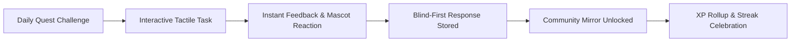

# 06 — Gamification, Community Mirror, and Trust Architecture

**Product:** Lipi Sabha (लिपि सभा)  
**Gamification Philosophy:** Duolingo-grade intrinsic motivation & joyful learning loops without manufactured political consensus or majority bias.  
**Visual & Mascot System:** [`00-design-system.md`](./00-design-system.md)  
**Core Interaction Loop:**  
`Discover Script → Answer Blind → Reveal Community Mirror → Reflect & Learn → Contribute Variant`

---

## 1. The Playful Motivation Engine

Educational psychology demonstrates that learners thrive when high-stakes barriers are replaced with playful tactile feedback, clear daily progression, and empathetic mascot encouragement. However, because Lipi Sabha facilitates **community language research**, gamification must reward **curiosity, effort, and linguistic integrity**, never ideological conformity or dialect favoritism.

---

## 2. Gamification Mechanics

### A. Experience Points (XP) Economy
XP is strictly tied to verifiable learning engagement, never to poll outcomes or voting for a majority script:
* **Complete a Quest (3–5 tasks):** `+10 XP`
* **Daily Scribe Bonus (first quest of the day):** `+5 XP`
* **Optional Reflection / Context Note:** `+2 XP` (capped at 1 per quest)
* **Verified Variant Contribution with Citation/Provenance:** `+15 XP` (awarded only after reviewer review)
* **Idempotency Guarantee:** All XP awards are written to an append-only `xp_ledger` table with unique constraint `(user_id, event_type, reference_id)`. Page refreshes or network retries can never double-credit XP.

### B. Scribe Ranks (लिपिकार पदवी — Progression Ladder)
As participants practice scripts and compare orthographies, their lifetime XP advances them through prestigious, culturally respectful scribe ranks:

| Rank | Title | Lifetime XP Threshold | Badge Unlock | Mascot Interaction |
|:---:|---|:---:|---|---|
| **1** | **Akshara Jigyasu** (Letter Curious) | 0 XP | Starter Quill | Mascot waves hello with reed pen |
| **2** | **Pathaka** (Novice Reader) | 50 XP | First Scroll | Mascot bows and hands over a scroll |
| **3** | **Lipi Shishya** (Script Apprentice) | 200 XP | Bronze Inkpot | Mascot wears student spectacles |
| **4** | **Lipi Kovid** (Skilled Scribe) | 500 XP | Silver Stylus | Mascot draws decorative script flourishes |
| **5** | **Puratattva Mitra** (Epigraphist) | 1,200 XP | Golden Manuscript | Mascot reads from a palm-leaf codex |
| **6** | **Lipi Ratna** (Guardian of Scripts) | 3,000 XP | Crown of Letters | Full celebratory golden confetti burst |

### C. Scribe Sadhana (Daily Streaks & Non-Punitive Mechanics)
* **The Streak Flame:** Displayed in the top nav with Coral Fire accent (`#ff4b4b`). Every day the user completes at least one 3-minute quest, the streak advances.
* **Ink Saver (Streak Freeze):** Each user starts with 1 free Ink Saver. If a day is missed, an Ink Saver is automatically consumed rather than extinguishing the streak.
* **Anti-Shame Design:** Unlike aggressive commercial apps, Lipi Sabha never sends guilt-inducing push notifications. If a streak resets, the mascot warmly says: *"Welcome back, Scribe! Every day you look at a script keeps its memory alive."*

### D. The Scribe Mascot: "Lipi"
A charming, hand-crafted mascot: a scholarly little owlet/bird holding an ancient reed stylus (`kalam`).
* **Idle State:** Perched calmly on top of the quest card, blinking playfully.
* **Typing / Tracing State:** Peeks attentively at the user's canvas.
* **Success State:** Springs upward with a happy hop and flapping wings.
* **Instructive / Multiple Forms State:** Scratches head thoughtfully, holding up an explanatory manuscript banner.

### E. Celebration Audio-Visual Loop
Upon completing the final task of a quest:
1. **Screen Pause (200ms):** Focus shifts to the center canvas.
2. **Confetti Burst:** A shower of 60 flat-shaded particles (Eager Green, Spark Blue, Sun Yellow, Coral Fire).
3. **Counter Rollup:** XP tally ticks up from 0 to +10 with rhythmic audio ticks.
4. **Card Reveal:** Tactile summary card glides up using velocity-matched ease (`cut-the-curve`).

---

## 3. Community Mirror: The Trust Gasket

The **Community Mirror** is Lipi Sabha's defining innovation: it solves the conformity bias problem in linguistic fieldwork.

### The Blind-First Interaction Law
1. When a user encounters a candidate orthography comparison (e.g. Word A in Classical Modi vs Word A in Devanagari), **no aggregate percentage is visible**.
2. The user submits their personal reading or preference blind.
3. Once the server confirms receipt of the response, the card flips smoothly to reveal the Community Mirror.

### Data Transparency & Protective Rules
* **Sample Size Transparency:** Always displays total cohort count: *"Based on 142 responses from community participants"*.
* **Small-Cohort Privacy Guard:** If a dialect or regional subgroup has fewer than $N=5$ participants, the breakdown by subgroup is automatically masked (`is_suppressed = true`), displaying: *"Cohort too small for subgroup breakdown (< 5 participants)"*.
* **Non-Judgmental Copy:**
  * ✅ *"You chose Form A. 62% of participants in this sample also selected Form A."*
  * ✅ *"Responses in this quest show wide variation across regional dialects."*
  * ❌ Never: *"You are wrong"* or *"Form A is the winner"*.

---

## 4. Ethical Safeguards Against Gamification Manipulation

1. **Zero XP for Voting:** Voting in a consultation poll awards **0 XP**. This prevents users from spamming polls to farm points.
2. **Zero XP for Majority Agreement:** Users receive the exact same XP whether their answer matches the majority or represents a unique minority dialect.
3. **No Public Competitions Between Native Speakers:** Lipi Sabha intentionally rejects public rank leaderboards that pit community members against each other.
4. **Synthetic Data Watermark:** All test/demo environments display a persistent banner: *"Illustrative synthetic demo project — not community-validated linguistic data"*.
5. **Auditable Community Sovereignty:** The platform provides empirical clarity, but the human community retains sovereign governance over all orthographic adoptions.
